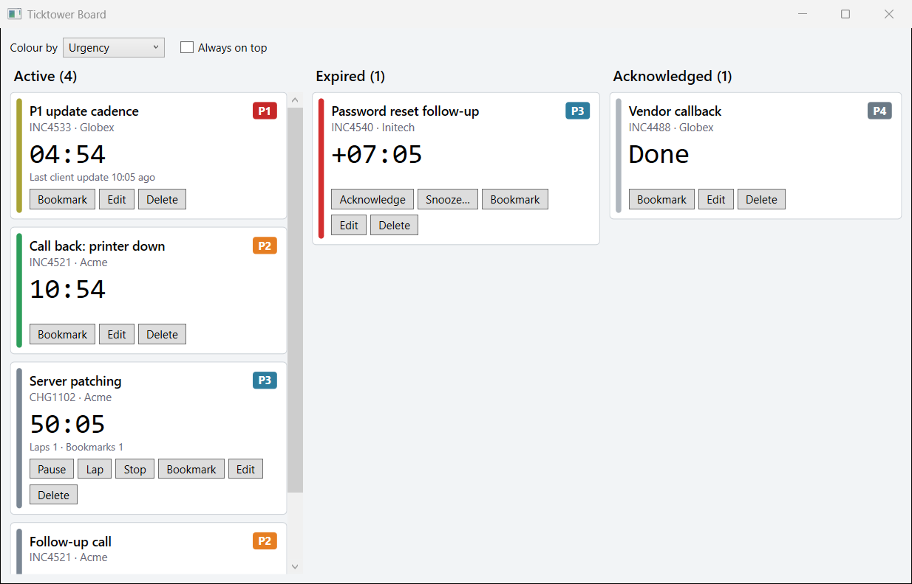
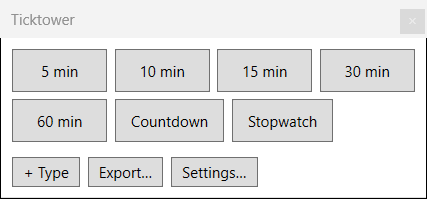
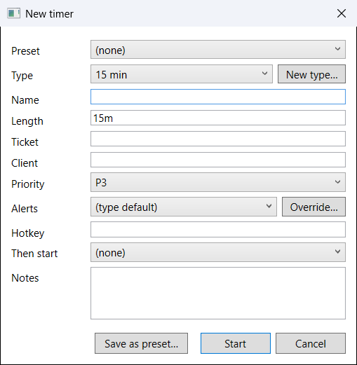
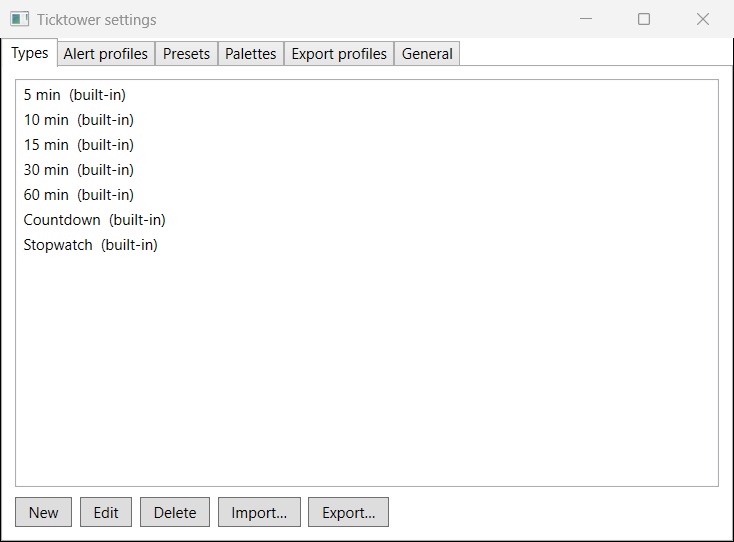
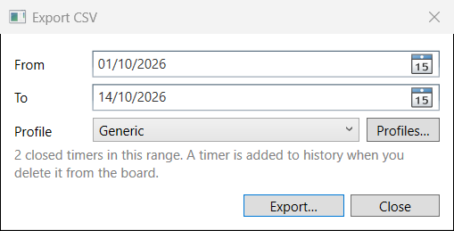

# Ticktower

Multi-timer desktop tool for MSP engineers. It tracks callbacks, task time, and P1 update cadence. An air-traffic-style board shows every timer.



Cards drop between the Active, Expired and Acknowledged lanes as their state changes. The coloured stripe shows urgency (green, then amber, then red), or priority, type or client if you switch the colour mode.

## Install

Ticktower is a single `.exe`. There is no installer and no admin rights are needed.

1. Install the **.NET 8 Desktop Runtime (x64)** if the PC does not have it: <https://dotnet.microsoft.com/download/dotnet/8.0>
2. Download `Ticktower-vX.Y.Z-win-x64.exe` from the [Releases](../../releases) page.
3. Put it anywhere you like and run it.

Each person runs their own copy. Nothing is shared between users, there is no telemetry, and the only network call is an optional update check against this repo's GitHub Releases (Settings > General turns it off).

Your data lives in `%AppData%\Ticktower\`. Delete that folder to start again.

## Using it



**Starting a timer.** The small always-on-top launcher has one button per timer type (5, 10, 15, 30 and 60 minute intervals, a countdown and a stopwatch). Click one to open the entry window, fill in name, ticket, client and priority, and press Start. Right-click a type button to edit that type. **+ Type** adds your own.



**Timer kinds**

| Kind | Behaviour |
|---|---|
| Countdown | Fires once. Acknowledge it when you have dealt with it. |
| Interval | Repeats at a fixed length. It restarts when you acknowledge it, and the card shows *time since last client update* so a late acknowledge does not hide a long gap. |
| Stopwatch | Counts up. Pause, resume, lap and stop. Run as many as you like at once. |

Every timer stores absolute UTC times, so sleeping or restarting the PC cannot make it drift. On launch anything that expired while the app was closed fires straight away.

**Alerts.** When a timer expires Ticktower climbs an *escalation ladder*. The default is toast, then toast and sound, then overlay and sound, then overlay and speech, one rung every minute until you acknowledge or snooze. Channels are toast, sound, taskbar flash, full-screen overlay and text to speech. Edit the ladder, sound file, volume and speech text per **alert profile** in Settings, or override any of them for a single timer from the entry window. Alerts fire while the app is minimised to the tray.

**Snooze.** The Snooze button on a card offers your preset lengths and a custom one (`7`, `90s`, `1h30m`). Toasts and the overlay use your first preset.

**Chains.** Pick *Then start* in the entry window to queue another timer behind the first. It waits as "Queued" and starts when the first is acknowledged (or stopped, for a stopwatch).

**Hotkeys.** Give a type or a timer a global hotkey such as `Ctrl+Alt+K` (at least one modifier). A type hotkey starts a new timer, and a stopwatch type toggles its running stopwatch between running and paused. If Windows refuses a combination because another app owns it, the launcher shows why.

**Presets.** *Save as preset* in the entry window stores a whole configuration, for example "Client X P1 = 15 min interval, escalation ladder 2". Presets appear on the launcher.

**Tray.** Minimising or closing a window sends Ticktower to the tray. The tray menu shows the board or launcher, starts a timer, mutes sound and speech, opens export and settings, and exits.



**Settings** holds your types, alert profiles, presets, colour palettes and export profiles, each with Import and Export as JSON so a team can share a setup. Imports never overwrite built-in items.

## Exporting to CSV



A timer is written to history, `history\YYYY-MM.jsonl`, with its full event log when you **delete** it from the board. Export picks closed timers by date range and writes them using an **export profile**:

- delimiter, quoting (minimal, all, or non-numeric) and encoding (UTF-8 with BOM by default, UTF-8, Latin-1, UTF-16)
- one row per timer, or one row per event (so laps and bookmarks get rows of their own)
- columns you can enable, reorder and rename, each with an optional format
- dates as ISO 8601 or any pattern such as `yyyy-MM-dd HH:mm` (UTC), and durations as `hh:mm:ss`, decimal hours or minutes

Duration is the running time of a stopwatch (pauses excluded), or start to last acknowledge for a countdown or interval. Free text that starts with `=`, `+`, `-` or `@` gets a leading apostrophe by default so a spreadsheet cannot run it as a formula.

Built-in profiles are **Generic** and **PSA-ready**. The PSA layout is a placeholder until the real import format is known: edit the profile to remap it.

## Build from source

Needs the .NET SDK 8 or newer and Windows.

```
dotnet build
dotnet test
dotnet publish src/Ticktower -c Release -r win-x64 --self-contained false -p:PublishSingleFile=true
```

Set `TICKTOWER_DATA` to a folder to run a sandboxed copy with its own data, beside your real one.

The GitHub Actions workflow in `.github/workflows/release.yml` tests, publishes the single-file exe, attests it (build provenance) and attaches it to a GitHub release. A push to `main` makes a pre-release; run the workflow manually (Actions > Build and Release > Run workflow) and pick patch, minor or major to tag and publish a full release. Check a download with `gh attestation verify <exe> --repo danrhodes/Ticktower`.

## Project layout

```
src/Ticktower/        WPF app: windows, tray, alert channels, hotkeys
src/Ticktower.Core/   Timer model, state machine, engine, storage, export (no UI references)
tests/Ticktower.Tests/
GUIDE.md              The spec every session works from
TRACKER.md            Task list, decisions and session log
```

## Licence

MIT. See [LICENSE](LICENSE).
